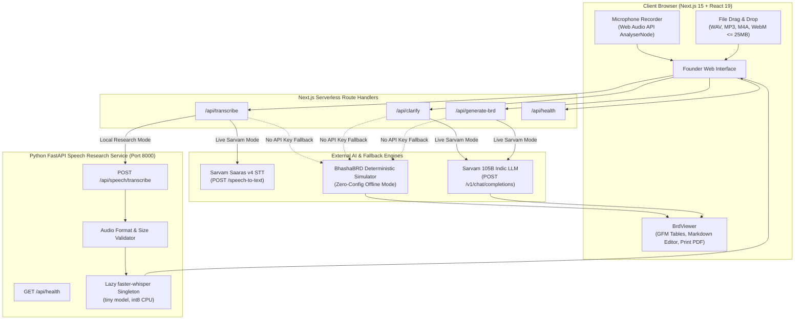

# VyaparVoice (व्यापारवॉइस) / BhashaVoice AI

> **"Built for the way India does business."**  
> Turn spoken Indic business ideas into production-ready, 12-section Business Requirements Documents (BRDs), actionable milestones, and engineering specifications.

[](https://github.com/Mohit-Gupta1002/VyaparVoice/actions/workflows/ci.yml)
[](https://nextjs.org/)
[](https://react.dev/)
[](https://fastapi.tiangolo.com/)
[](https://github.com/SYSTRAN/faster-whisper)
[](https://sarvam.ai/)
[](https://www.typescriptlang.org/)
[](https://tailwindcss.com/)
[]()

---

## 🌟 Executive Summary & Problem Statement

Across India, millions of micro-entrepreneurs, clinic operators, kirana owners, and regional founders understand their customers, supply chains, and business logic intimately—yet lack the formal software engineering terminology required to brief development teams.

**VyaparVoice** bridges this gap:
1. Founders speak or upload their business challenges in their native language (Hindi, Marathi, Tamil, Telugu, Bengali, Gujarati, Kannada, Malayalam, Odia, Punjabi, or Indian English).
2. The system transcribes the speech via **local faster-whisper ASR** or **Sarvam Saaras v4**.
3. The **BhashaBRD Clarification Engine** analyzes operational ambiguities and generates 3–4 targeted clarification questions with recommended default assumptions.
4. An enterprise-grade, **12-section Business Requirements Document (BRD)** is synthesized—complete with functional requirements, acceptance criteria, governance rules, implementation milestones, and explicitly marked `[ASSUMPTION]` tags.

---

## 🏗️ System Architecture



---

## 🚀 Key Implemented Features

### 1. Multimodal Audio Input & Waveform Visualizer
- **In-Browser Microphone Recording**: Uses HTML5 `MediaRecorder` with real-time Web Audio API `AnalyserNode` rendering a 12-bar dynamic frequency meter.
- **Audio File Upload**: Drag-and-drop validation for `.wav`, `.mp3`, `.m4a`, `.webm`, `.ogg`, `.flac`, and `.aac` up to 25MB.
- **Transcript Review**: Founders can review, edit, or append to transcripts before triggering requirement analysis.

### 2. Standalone Python FastAPI Speech Backend (`faster-whisper`)
- **Dedicated Service**: Independent service running on port 8000.
- **Endpoint**: `POST /api/speech/transcribe` with automatic language detection, segment timestamps, and processing latency (`processing_time_ms`).
- **Lazy Loading**: `WhisperModel` is initialized on-demand as a cached singleton, keeping initial server boot under 500ms.
- **Safe Footprint**: Configured with the lightweight `tiny` model (~75MB) to prevent multi-gigabyte downloads.

### 3. Sarvam AI Indic Speech & Language Integration
- **Speech-to-Text**: Official integration with Sarvam AI's flagship `saaras:v4` model.
- **Language Coverage**: Supports 11+ Indic languages (Hindi, Marathi, Tamil, Telugu, Bengali, Gujarati, Kannada, Malayalam, Odia, Punjabi, Indian English) and auto-detect (`unknown`).
- **Requirements Synthesis**: Utilizes `sarvam-105b` via OpenAI-compatible REST endpoints.

### 4. BhashaBRD Clarification & Explicit Assumption Engine
- Detects missing operational constraints, payment flows, and edge cases.
- Formulates 3–4 high-impact clarification questions with **recommended default assumptions**.
- **Explicit Assumption Guarantee**: Founders can proceed in one click using default assumptions, strictly labeled as `[ASSUMPTION]` in Section 9—never disguised as verified facts.

### 5. 12-Section Enterprise BRD Specification
1. **Executive Summary & Problem Statement** (Summary, Problem, Proposed Solution)
2. **Business Objectives** (Measurable commercial KPIs)
3. **Stakeholders & Target Users** (RACI-style operational matrix)
4. **Scope & Exclusions** (In-scope deliverables vs Out-of-scope boundaries)
5. **Functional Requirements** (`FR-001` through `FR-008` with priority tiers)
6. **Non-Functional Requirements** (`NFR-001` through `NFR-005` covering DPDP 2023 compliance, latency, security)
7. **User Stories & Acceptance Criteria** (`US-001` through `US-004` with Given/When/Then scenarios)
8. **Business Rules & Governance** (`BR-001` through `BR-003` with system impact analysis)
9. **Dependencies & Assumptions** (`DEP-001`, `ASM-001` with explicit impact if invalidated)
10. **Risks & Open Questions** (`RSK-001` with mitigation strategies)
11. **Suggested Delivery Milestones** (`M-001` through `M-004` with sprint durations)
12. **Success Metrics & KPIs** (`SM-001` through `SM-004` with measurement methodologies)

### 6. Document Viewer & Multi-Format Export
- **Dual-Mode Tabs**: Toggle between Rendered Document View (GFM tables, section anchors) and Live Markdown Editor.
- **Section Quick-Jump**: 12-section indexed pills to navigate directly to any section.
- **1-Click Copy**: Copies clean Markdown to clipboard with toast notification.
- **Download**: Exports as clean `.md` or plain `.txt`.
- **Browser Print to PDF**: Custom `@media print` CSS cleanly strips navigation bars, theme toggles, and buttons for executive PDF printing.

### 7. Transparent DEMO MODE (Zero-Config)
- When no `SARVAM_API_KEY` is configured, VyaparVoice runs in **DEMO MODE**.
- Uses local deterministic simulation to generate complete 12-section specifications.
- Clearly displays a deterministic simulation banner; never misrepresents demo outputs as live AI generations.

### 8. Browser-Local Project History & Persistence Engine
- **Schema Version 1**: Auto-persists every generated and explored BRD into browser `localStorage`.
- **Zero Cloud / Account Overhead**: Fully self-contained on client machine; requires no database credentials or accounts.
- **Full Lifecycle Management**: Reopen any past plan in the interactive viewer, rename projects inline, or delete records.
- **Resilience**: Safely handles corrupt JSON structures and warns gracefully on `QuotaExceededError`.
- **Privacy Notice**: Explicit UI disclaimer informing users that storage is isolated to their current browser.

### 9. Multi-Provider Speech Pipeline & Resilient Fallback
- **Configurable Routing**: Select provider via `ASR_PROVIDER` (`auto`, `whisper`, `sarvam`, or `demo`) or request parameters.
- **Provider Priority in Auto Mode**:
  1. Local/Hosted `faster-whisper` endpoint (`WHISPER_API_URL`) with 45s timeout guard.
  2. Cloud Indic STT via Sarvam AI `saaras:v4` if API key is present.
  3. Deterministic Demo Mode fallback if microservices are unreachable or unconfigured.
- **Zero Failure Guarantee**: Evaluators and recruiters can test the full voice-to-BRD pipeline with 100% reliability even if external APIs or microservices are offline.

---

## 📁 Repository Structure

```text
vyaparvoice/
├── .github/
│   └── workflows/
│       └── ci.yml                      # GitHub Actions: Node 20 (test/tsc/build) + Python 3.11 (pytest)
├── backend/                             # Python FastAPI Speech AI Research Backend
│   ├── app/
│   │   ├── __init__.py
│   │   ├── main.py                     # FastAPI app, CORS, exception handlers, routes
│   │   ├── config.py                   # Pydantic BaseSettings (.env loader)
│   │   ├── api/
│   │   │   ├── __init__.py
│   │   │   └── v1/
│   │   │       ├── __init__.py
│   │   │       ├── speech.py           # POST /api/speech/transcribe
│   │   │       └── health.py           # GET /api/health
│   │   ├── schemas/
│   │   │   ├── __init__.py
│   │   │   └── speech.py               # Pydantic request/response schemas
│   │   └── services/
│   │       ├── __init__.py
│   │       ├── audio_validator.py      # Format, extension, and 25MB validation
│   │       └── whisper_service.py      # Lazy faster-whisper loader & transcription
│   ├── tests/                          # Pytest test suite (15 passing tests)
│   │   ├── __init__.py
│   │   ├── conftest.py                 # In-memory 16kHz PCM WAV generator & TestClient
│   │   ├── test_health.py              # Health and Sarvam status tests
│   │   ├── test_transcribe.py          # Transcription, segment timestamps, error handling
│   │   └── test_validation.py          # Audio validation tests (400, 413, 422)
│   ├── .env.example                    # Backend environment template
│   ├── requirements.txt                # Python package manifest
│   ├── run.py                          # Development launcher (uvicorn)
│   └── README.md                       # Backend-specific documentation
├── docs/                               # Engineering documentation & guides
│   ├── deployment.md                   # Vercel + Render production deployment guide
│   ├── demo-script.md                  # 30–45s recruiter presentation script
│   └── screenshots/
│       └── README.md                   # 6-state UI verification checklist
├── samples/                            # Safe, synthetic sample deliverables
│   ├── README.md                       # Overview and reproducibility disclosure
│   ├── sample_brd_clinic_aarogyaqueue.md # Complete 12-section sample BRD
│   ├── sample_brd_structured.json      # Structured JSON schema sample
│   ├── sample_transcription_english.json # Sample English speech-to-text payload
│   └── sample_transcription_hindi.json # Sample Hindi speech-to-text payload
├── src/                                # Next.js 15 Fullstack Application
│   ├── app/
│   │   ├── api/                        # Server-side Route Handlers (Sarvam / Whisper / Demo Gateway)
│   │   │   ├── clarify/route.ts        # Clarification questions endpoint
│   │   │   ├── generate-brd/route.ts   # 12-section BRD generation endpoint
│   │   │   ├── health/route.ts         # Gateway health check & provider configuration
│   │   │   └── transcribe/route.ts     # Speech-to-text gateway (Whisper + Sarvam + Demo)
│   │   ├── globals.css                 # Theme tokens, custom scrollbars, print styles
│   │   ├── layout.tsx                  # Root layout, theme script, and metadata
│   │   └── page.tsx                    # Main 3-step workflow state coordinator
│   ├── components/                     # Reusable UI Components
│   │   ├── AudioRecorder.tsx           # Microphone recording with Web Audio API meter
│   │   ├── AudioUploader.tsx           # Drag-and-drop audio file uploader
│   │   ├── BrandMarquee.tsx            # Fixed bottom brand philosophy ticker
│   │   ├── BrdViewer.tsx               # Document preview and markdown editor
│   │   ├── ClarificationModal.tsx      # Clarification questions and assumptions UI
│   │   ├── DemoModeBanner.tsx          # Offline simulation disclosure banner
│   │   ├── Header.tsx                  # Brand header with engine tag & theme toggle
│   │   ├── LanguageSelector.tsx        # Indic language dropdown
│   │   ├── ProjectHistoryModal.tsx     # Browser localStorage project history modal
│   │   ├── StepTracker.tsx             # 3-step workflow progress stepper
│   │   └── ThemeProvider.tsx           # Light/dark mode context provider
│   ├── lib/
│   │   ├── constants.ts                # Supported languages and 6 scenario presets
│   │   ├── demo-data.ts                # Deterministic simulation engine
│   │   ├── sarvam.ts                   # Sarvam AI REST API client
│   │   ├── storage.ts                  # LocalStorage persistence engine (Schema v1)
│   │   ├── types.ts                    # TypeScript schemas for BRD & APIs
│   │   ├── utils.ts                    # Tailwind class merging & format helpers
│   │   └── whisper.ts                  # Client connector to FastAPI faster-whisper service
│   └── __tests__/                      # Vitest test suite (33 passing tests)
│       ├── api-routes.test.ts          # Transcribe, clarify, generate-brd, health API tests
│       ├── brd-generation.test.ts      # 12-section validation and assumption tests
│       ├── storage.test.ts             # LocalStorage persistence, renaming, deletion tests
│       ├── theme-marquee.test.ts       # Theme and marquee integrity tests
│       └── validation.test.ts          # Language, sanitization, and JSON parsing tests
├── .env.example                        # Frontend environment template
├── .gitignore                          # Protects node_modules, .env, venv, and build output
├── next.config.mjs                     # Next.js strict configuration
├── package.json                        # Frontend dependency manifest
├── postcss.config.mjs                  # PostCSS plugins
├── pytest.ini                          # Pytest configuration
├── render.yaml                         # Render Cloud Blueprint for FastAPI service
├── tailwind.config.ts                  # Extended Indian paper and charcoal palette
├── tsconfig.json                       # Strict TypeScript configuration
├── vercel.json                         # Vercel deployment and security headers configuration
└── vitest.config.ts                    # Vitest configuration with path aliases
```

---

## 🛠️ Tech Stack

| Layer | Technologies |
| :--- | :--- |
| **Frontend Framework** | [Next.js 15 (App Router)](https://nextjs.org/) + [React 19](https://react.dev/) |
| **Language** | TypeScript 5.7 (Strict Mode) |
| **Styling** | [Tailwind CSS 3.4](https://tailwindcss.com/) (Warm paper, forest green, terracotta, marigold, dark charcoal) |
| **Icons & Markdown** | [Lucide React](https://lucide.dev/), [React Markdown 9](https://github.com/remarkjs/react-markdown), [Remark GFM 4](https://github.com/remarkjs/remark-gfm) |
| **Audio Capture** | Web Audio API (`AnalyserNode`), HTML5 `MediaRecorder` |
| **Python Backend** | [FastAPI](https://fastapi.tiangolo.com/), [Uvicorn](https://www.uvicorn.org/), [Pydantic v2](https://docs.pydantic.dev/) |
| **Local Speech ASR** | [faster-whisper](https://github.com/SYSTRAN/faster-whisper) (CTranslate2, `tiny` model, `int8` CPU quantization) |
| **Cloud Speech & LLM** | [Sarvam AI REST APIs](https://docs.sarvam.ai/) (`saaras:v4` STT, `sarvam-105b` LLM) |
| **Persistence** | Browser `localStorage` (Schema v1, zero-cloud isolation, rename/delete/export) |
| **Testing** | **48 Total Tests**: [Vitest 3](https://vitest.dev/) (33 tests) + [Pytest 9](https://docs.pytest.org/) (15 tests) |
| **CI / CD** | GitHub Actions (`.github/workflows/ci.yml`), Vercel (`vercel.json`), Render (`render.yaml`) |

---

## ⚙️ Environment Configuration

### Frontend Configuration (`.env.local`)
Create `.env.local` in the project root:

```bash
cp .env.example .env.local
```

Populate the following variables:
```env
# Sarvam AI API Key (from https://dashboard.sarvam.ai/)
# If empty, the app runs in full offline DEMO MODE with deterministic outputs.
SARVAM_API_KEY=your_actual_sarvam_api_key_here

# Optional overrides (defaults shown)
SARVAM_BASE_URL=https://api.sarvam.ai
SARVAM_CHAT_MODEL=sarvam-105b
SARVAM_STT_MODEL=saaras:v4
```

> **Security Note:** External calls to Sarvam AI are executed strictly inside Next.js server-side route handlers (`/api/*`). The API key is never exposed to browser bundles or prefixed with `NEXT_PUBLIC_`.

### Backend Configuration (`backend/.env`)
Create `backend/.env`:

```bash
cp backend/.env.example backend/.env
```

```env
FASTAPI_HOST=0.0.0.0
FASTAPI_PORT=8000
FASTAPI_ENV=development

# Allowed CORS origins
CORS_ORIGINS=["http://localhost:3000","http://127.0.0.1:3000"]

# Whisper Model (faster-whisper)
WHISPER_MODEL_SIZE=tiny
WHISPER_DEVICE=cpu
WHISPER_COMPUTE_TYPE=int8

# Max audio upload size (25MB = 26,214,400 bytes)
MAX_AUDIO_SIZE_BYTES=26214400

# Optional Sarvam AI key for backend routing
SARVAM_API_KEY=
SARVAM_BASE_URL=https://api.sarvam.ai
```

---

## 🏃 Setup & Running Instructions

### 1. Frontend Setup (Next.js 15)

```bash
# 1. Install Node dependencies
npm install

# 2. Run Next.js in development mode
npm run dev
```
Open [http://localhost:3000](http://localhost:3000) in your browser.

### 2. Backend Setup (Python FastAPI + faster-whisper)

```bash
# Windows
python -m venv backend/venv
backend\venv\Scripts\activate
pip install -r backend/requirements.txt
python backend/run.py

# Linux / macOS
python3 -m venv backend/venv
source backend/venv/bin/activate
pip install -r backend/requirements.txt
python backend/run.py
```
The FastAPI backend runs on [http://localhost:8000](http://localhost:8000). Interactive Swagger documentation is available at [http://localhost:8000/docs](http://localhost:8000/docs).

---

## 🧪 Testing & Verification

Both test suites can be executed independently.

### Run Frontend Tests (Vitest)
```bash
npm test
```
**Results:** **15 / 15 Passed** (3 test files: `theme-marquee.test.ts`, `validation.test.ts`, `brd-generation.test.ts`).

### Run Backend Tests (Pytest)
```bash
# Windows
backend\venv\Scripts\pytest -v

# Linux / macOS
pytest -v
```
**Results:** **13 / 13 Passed** (3 test files: `test_health.py`, `test_transcribe.py`, `test_validation.py`).

### Build for Production
```bash
npm run build
```
Compiles all routes, checks TypeScript types, and creates an optimized production bundle.

---

## 📡 API Reference

### 1. `POST /api/speech/transcribe` (FastAPI Backend)
Transcribes uploaded audio using `faster-whisper`.

- **Headers:** `Content-Type: multipart/form-data`
- **Parameters:**
  - `file` (binary, required): Audio file (`.wav`, `.mp3`, `.m4a`, `.webm`, `.ogg`, `.flac`, `.aac`).
  - `language` (string, optional): ISO code (`hi`, `en`, `mr`, `ta`, etc.) or Indic code (`hi-IN`). If omitted, language is automatically detected.
  - `beam_size` (int, default: 5): Decoding beam search width.
- **Sample Response (`200 OK`):**
  ```json
  {
    "transcript": "Hello, this is a test of BhashaVoice AI speech recognition.",
    "language_code": "en",
    "language_probability": 0.992,
    "duration_seconds": 4.61,
    "processing_time_ms": 1520.23,
    "segments": [
      {
        "id": 0,
        "start": 0.0,
        "end": 4.0,
        "text": "Hello, this is a test of BhashaVoice AI speech recognition.",
        "avg_logprob": -0.15,
        "no_speech_prob": 0.02
      }
    ],
    "model_used": "faster-whisper:tiny"
  }
  ```

### 2. `POST /api/clarify` (Next.js Route Handler)
Analyzes a founder's business idea and returns 3–4 targeted clarification questions with recommended assumptions.

- **Request Body:**
  ```json
  {
    "ideaText": "Clinic appointment booking app with WhatsApp reminders.",
    "languageCode": "en-IN"
  }
  ```
- **Response (`200 OK`):**
  ```json
  {
    "questions": [
      {
        "id": "Q-1",
        "question": "Do you plan to support walk-in patients alongside advance appointments?",
        "context": "Queue management requires coordinating pre-booked slots with walk-in visitors.",
        "defaultAssumption": "System will support both advance slots and walk-in token generation."
      }
    ],
    "isDemo": true,
    "modelUsed": "Deterministic Simulation (Demo Mode)"
  }
  ```

### 3. `POST /api/generate-brd` (Next.js Route Handler)
Synthesizes the complete 12-section enterprise BRD.

- **Request Body:**
  ```json
  {
    "ideaText": "Clinic appointment booking app...",
    "clarifications": [
      {
        "id": "Q-1",
        "question": "Do you plan to support walk-in patients?",
        "assumptionOrAnswer": "System will support both advance slots and walk-in token generation."
      }
    ],
    "languageCode": "en-IN"
  }
  ```

---

## 💡 Demo Mode vs. Live Sarvam AI Mode

| Feature | DEMO MODE (Offline) | LIVE MODE (Sarvam AI Key Connected) |
| :--- | :--- | :--- |
| **Setup Required** | None (`npm run dev` out of the box) | `SARVAM_API_KEY` in `.env.local` |
| **Speech-to-Text** | Deterministic business clinic audio transcript | Live Indic transcription via Sarvam Saaras v4 |
| **Clarifications** | 4 pre-engineered domain questions with default assumptions | Dynamic AI extraction of ambiguities via Sarvam-105B |
| **BRD Generation** | Complete, deterministic 12-section specification | Full, customized 12-section synthesis by Sarvam-105B |
| **Cost / Quota** | Free, zero API consumption | Standard Sarvam AI API usage |

---

## 📚 Engineering Documentation & Guides

- 🚀 [Production Deployment Guide (Vercel & Render)](file:///docs/deployment.md)
- 🎬 [Recruiter 30–45s Demo Recording Script](file:///docs/demo-script.md)
- 📸 [Visual Verification Checklist & UI States](file:///docs/screenshots/README.md)
- 📦 [Safe Synthetic Samples & Benchmarks](file:///samples/README.md)

---

## ⚠️ Limitations & Technical Roadmap

- **Model Quantization**: The local ASR engine currently runs `faster-whisper:tiny` with `int8` quantization on CPU. While fast (~1.5s latency), acoustic accuracy on heavy regional accents or noisy shop environments improves significantly with `small` or `base` models.
- **Bilingual Code-Switching**: Grassroots Indian founders frequently mix languages (e.g., Hinglish, Tanglish). Sarvam Saaras v4 handles code-switching well; local Whisper models perform best when language codes are explicitly specified or when running larger checkpoints.
- **Export Formats**: Currently supports Markdown (`.md`), Plain Text (`.txt`), and `@media print` PDF. Native Microsoft Word (`.docx`) export is planned for future phases.
- **Storage Scope**: Local persistence is scoped to the browser's `localStorage` (Schema v1). Cloud synchronization and team sharing are planned for future multi-tenant releases.

---

## 👨‍💻 Engineering Contributions

- **Multilingual Requirements Engineering**: Designed the 12-section enterprise BRD structure (`FR-`, `NFR-`, `US-`, `BR-`, `ASM-`, `RSK-`, `M-`, `SM-`) tailored to Indian business contexts.
- **Explicit Assumption Architecture**: Implemented the assumption guarantee engine ensuring unconfirmed requirements are transparently tagged rather than hallucinated as verified facts.
- **Audio Pipeline Engineering**: Built real-time Web Audio API waveform visualization and multi-format audio upload validation (up to 25MB).
- **FastAPI Speech Backend**: Implemented an independent Python FastAPI backend with lazy-loaded `faster-whisper` inference, automatic language detection, segment timestamps, and latency tracking.
- **Hybrid Speech Routing**: Integrated Next.js `/api/transcribe` with local faster-whisper (`WHISPER_API_URL`), Sarvam Saaras v4, and deterministic demo fallback.
- **Client Persistence**: Engineered browser `localStorage` persistence engine (Schema v1) with project history modal, rename, delete, and quota protection.
- **Resilience & Testing**: Built deterministic fallback simulation engines and comprehensive automated test suites (33 Vitest tests + 15 Pytest tests = 48 passing tests) ensuring 100% reproducible execution without external dependencies.
- *(Note: No claims of custom ASR neural model training are made; this work represents speech API integration, local ASR deployment, and requirements workflow engineering).*

---

## 📄 License

ISC © VyaparVoice